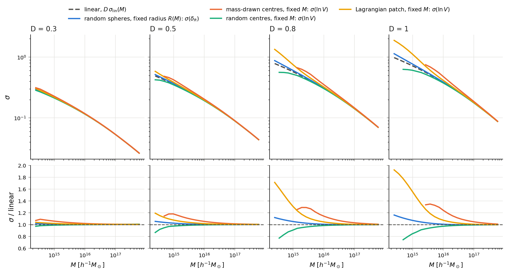
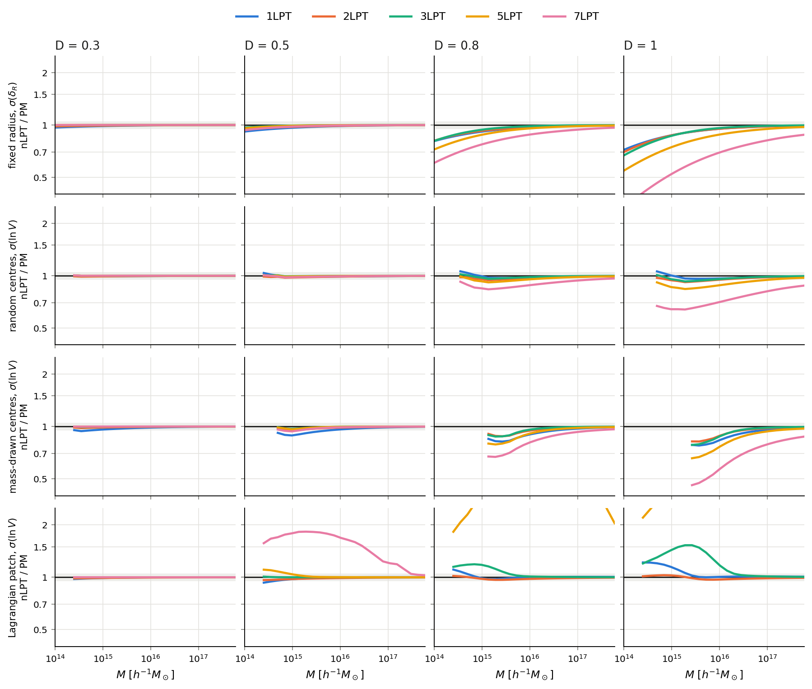
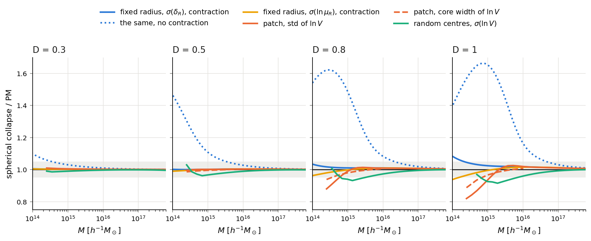
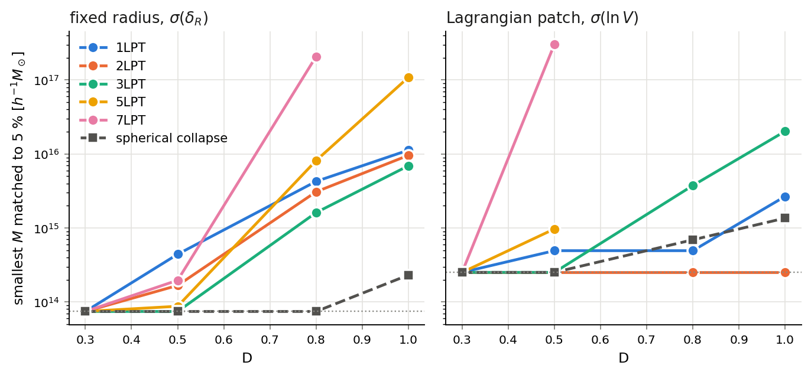
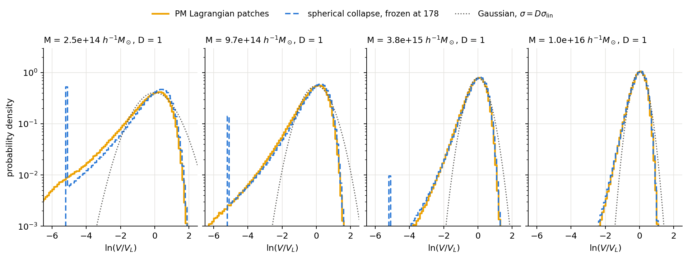
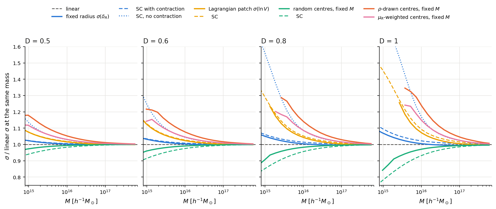
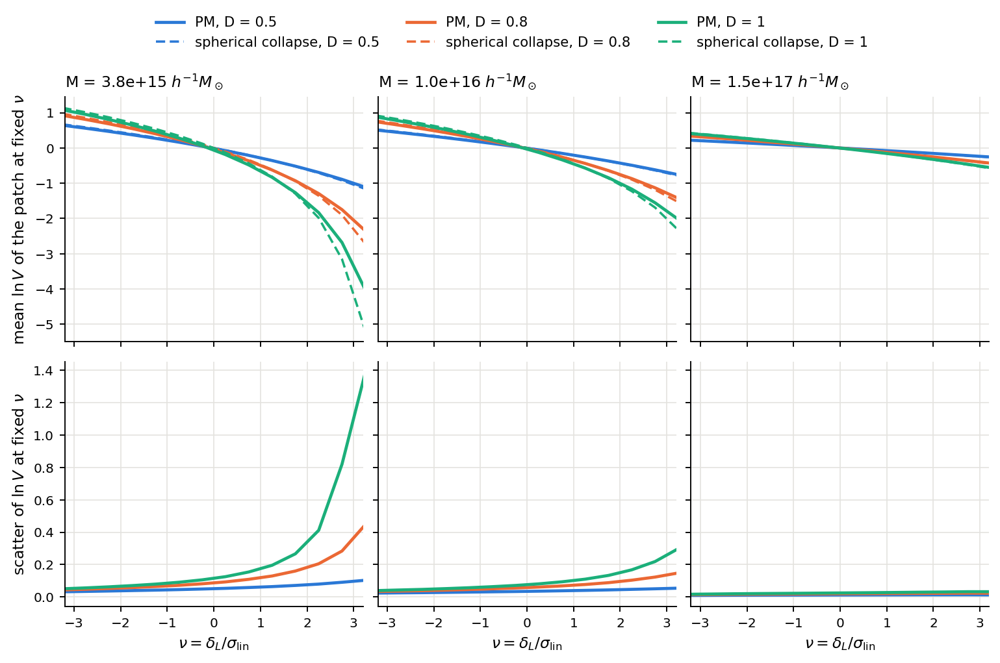
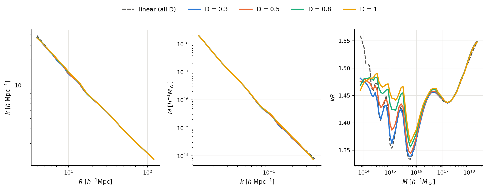

# Report C: σ(M), how well LPT and spherical collapse match

Scripts: `twoloop/sigmaM.jl`, `sigmaM_analysis.py`, `sigmaM_lpt_queue.sh`, `sigmaM_lpt.py`, `sigmaM_sc.py`, `sc_lowmass.py`, `patch_anisotropy.py`, `patch_analysis.py`, `pk_snap.jl`, `k_of_R.py`, `k_of_R_nowiggle.py`. Results: `results/sigmaM_*`, `sc_lowmass_*`, `patch_anisotropy_*`, `k_of_R_*`. The response of the variance to UV modes is in [report D](D_uv_reach.md).

## Summary

EdS with the Planck18 shape, cut at k = 1.6 h Mpc⁻¹ (`tl_full`), and a UV-divergent spectrum, P ∝ k⁻¹ above k = 0.3, with the same cut (`tl_div`). 4 seeds × ±L, L = 500 h⁻¹Mpc. Ratios are seed-matched, and errors exclude cosmic variance. Radii below are h⁻¹Mpc, and M ≈ 1.16 × 10¹² R³ h⁻¹M☉ for Ω_m = 1.

* **LPT is exact for this purpose until D ≈ 0.3, then stops improving with order.** At D = 0.3 all orders from 3LPT up match PM to ≤ 0.3 % at R ≥ 5 in `tl_full`. By D = 0.5 3LPT is the best order, and at D ≥ 0.8 5LPT and 7LPT are worse than Zel'dovich. No order recovers fixed-radius σ to 5 % below R ≈ 18 at D = 1.
* **LPT is always low at fixed radius and for centres drawn from the density,** and mass-drawn σ is its most sensitive test: at D = 1 the best order is 5 % off already at R₀ ≈ 29 (M ≈ 3 × 10¹⁶).
* **Spherical collapse with contraction reaches much smaller scales in the one-point variance:** to 5 % down to R ≈ 6 (M ≈ 2 × 10¹⁴) at fixed radius at D = 1 in `tl_full`, and R ≈ 11 in `tl_div`, against R ≈ 18 and 25 for the best LPT. It has no phase information, so this says nothing about the field.
* **At 1 %, spherical collapse is no better than 3LPT at D = 1** (both R ≈ 50). The residual at R = 20–30 has the size and sign of the UV suppression in report D, which spherical collapse lacks (not tested as a cause).
* **The limit depends on the statistic and on the small-scale power.** Patches fail at R₀ ≈ 9–11 at D = 1, random centres at R₀ ≈ 19, and more small-scale power moves the fixed-radius limit from R ≈ 6 to 11.

## 1. Definitions

M is labelled by R₀ with M = ρ̄V(R₀), Ω_m = 1 (about 3.2× the mass at the same radius for Ω_m = 0.31). 5 × 10¹⁵ h⁻¹M☉ is R₀ = 16.3.

| statistic | what is held fixed | centres |
|---|---|---|
| σ(δ_R) | Eulerian radius | uniform |
| random-centred σ(ln V) | mass | uniform |
| mass-drawn σ(ln V) | mass | drawn from ρ |
| Lagrangian patch σ(ln V) | the same mass elements | every mass element |

By P(R_M ≤ R) = P(M_R ≥ M), one weighted table F_m(R, μ) gives the volume distribution at fixed mass; it is the data-centred version of the kNN-CDF. Around points drawn from the density, the mean of δ_R is ξ̄(R), linear in P(k), while the variance is σ²(R) + ⟨δ δ_R²⟩ − ξ̄²(R), which includes an integrated bispectrum even at leading order.

Patch σ uses signed volumes, which count only the enclosing surface. Patches with a non-positive signed volume are clipped at ln V = ln 10⁻³, which inflates the standard deviation; core widths (q₈₄ − q₁₆)/2 are not affected, as long as those patches stay in the tail.

**Reach** at tolerance t is the smallest grid mass above which every grid point has |ratio − 1| ≤ t. "≤" means the grid ended first: R = 4 at fixed radius, R₀ = 6 for patches, and for random or mass-drawn centres wherever 2 % of the distribution leaves the radius range (R₀ = 6–7.5 and 6–13 respectively, growing with D). "None" means the statistic fails even at the largest scale.

## 2. PM against linear theory

*figM1: σ(M) at fixed radius, around random and mass-drawn centres at fixed mass, for Lagrangian patches, and in linear theory.*

Relative to linear σ at the same mass, D = 1, `tl_full`:

| M (h⁻¹M☉) | fixed radius | random centres | Lagrangian patch | mass-drawn |
|---|---|---|---|---|
| 3.7 × 10¹⁵ | +2.2 % | −5.7 % | +19 % | +35 % |
| 1.0 × 10¹⁶ | +0.5 % | −2.9 % | +7.0 % | +24 % |
| 1.5 × 10¹⁷ | −0.5 % | −0.5 % | +0.2 % | +3.3 % |

All statistics agree with linear σ at D = 0.1 to about 1 % for 6 × 10¹⁴ ≲ M ≲ 3 × 10¹⁶, and to about 1.5 % at 2.5 × 10¹⁴. Mass-drawn σ departs earliest and most.

Reweighting centres by the sphere's own μ_R rather than ρ(x) closes 55–65 % of the mass-drawn minus patch gap (0.690, 0.636, 0.607 at 3.7 × 10¹⁵). So most of it is centre density inside the sphere, and the rest is the difference between Eulerian spheres and Lagrangian patches. That split assumes this reweighting model. The unsigned sheet volume behaves very differently (0.379, 26 % below linear, at 3.7 × 10¹⁵, D = 1).

## 3. How well LPT matches

nLPT displacements, summed from the stored shapes of the same seeds, pass through the same estimator as PM. At D = 0.1, 7LPT and PM agree to 2 × 10⁻⁶ in σ(δ_R) and patch σ (one seed, s = +1).

*figM6: nLPT/PM for each statistic, `tl_full`. The band is ±5 %. Patch curves above the axis are 5LPT and 7LPT. [The divergent spectrum](../figures/figM6_sigma_lpt_tl_div.png) fails sooner.*

Fixed radius, nLPT/PM, `tl_full`, errors ≤ 0.06 %:

| D | R | 1LPT | 2LPT | 3LPT | 5LPT | 7LPT |
|---|---|---|---|---|---|---|
| 0.3 | 5 | 0.971 | 0.984 | 0.997 | 0.999 | 0.999 |
| 0.5 | 5 | 0.926 | 0.949 | 0.973 | 0.965 | 0.944 |
| 0.8 | 5 | 0.829 | 0.836 | 0.836 | 0.752 | 0.634 |
| 1 | 5 | 0.748 | 0.731 | 0.703 | 0.578 | 0.362 |
| 1 | 10 | 0.880 | 0.880 | 0.876 | 0.757 | 0.535 |
| 1 | 20 | 0.950 | 0.950 | 0.959 | 0.879 | 0.691 |
| 1 | 50 | 0.986 | 0.984 | 0.990 | 0.957 | 0.833 |

Mass-drawn σ(ln V), D = 1, `tl_full`, errors ≤ 0.4 %:

| R₀ | M | 1LPT | 2LPT | 3LPT | 5LPT | 7LPT |
|---|---|---|---|---|---|---|
| 14.8 | 3.8 × 10¹⁵ | 0.777 | 0.820 | 0.791 | 0.668 | 0.473 |
| 20.7 | 1.0 × 10¹⁶ | 0.837 | 0.887 | 0.880 | 0.768 | 0.571 |
| 29 | 2.8 × 10¹⁶ | 0.912 | 0.950 | 0.956 | 0.873 | 0.688 |
| 51 | 1.5 × 10¹⁷ | 0.968 | 0.982 | 0.989 | 0.951 | 0.816 |

Reach at 5 %, as a radius, `tl_full`:

| statistic | D | 1LPT | 2LPT | 3LPT | 5LPT | 7LPT | spherical collapse |
|---|---|---|---|---|---|---|---|
| fixed radius | 0.3 | ≤ 4 | ≤ 4 | ≤ 4 | ≤ 4 | ≤ 4 | ≤ 4 |
| | 0.5 | 7 | 5 | ≤ 4 | 4 | 6 | ≤ 4 |
| | 0.8 | 15 | 14 | 11 | 19 | 56 | ≤ 4 |
| | 1 | 21 | 20 | 18 | 45 | none | 6 |
| random centres | 0.5 | ≤ 6 | ≤ 6 | ≤ 6 | ≤ 6 | ≤ 6 | ≤ 6 |
| | 0.8 | 8 | 13 | ≤ 7 | 21 | 57 | 15 |
| | 1 | 8 | 23 | 19 | 51 | none | 19 |
| mass-drawn | 0.5 | 19 | 11 | ≤ 8 | ≤ 8 | 12 | no prediction |
| | 0.8 | 32 | 23 | 21 | 29 | 64 | no prediction |
| | 1 | 41 | 32 | 29 | 51 | none | no prediction |
| patch | 0.5 | 8 | ≤ 6 | ≤ 6 | 9 | 64 | ≤ 6 |
| | 0.8 | 8 | ≤ 6 | 15 | none | none | 8 |
| | 1 | 13 | ≤ 6 | 26 | none | none | 11 |

* **Convergence and then failure.** The series converges onto PM at D ≤ 0.3. Past that, higher order is worse, and the order of best agreement falls: 3LPT at D = 0.5–0.8, and at D = 1 1LPT, 2LPT and 3LPT are within about 1 % of each other at R ≥ 10. This is the same divergence as in the main study, now in a one-point statistic.
* **The divergent spectrum fails sooner** (D = 1, fixed radius, 5 %): 1LPT R = 25, 3LPT R = 43, 7LPT none. There 1LPT beats 3LPT from D = 0.8. At D = 1 7LPT gives only 2.5–7 % of PM's σ at R ≤ 50, so the structure has been scrambled. At D = 0.3, R = 5, 3LPT is 1.1 % low and 7LPT 3.4 % low.
* **Patch agreement needs care.** Series that overshoot turn patches inside out: at D = 1 the share with non-positive signed volume at R₀ = 6 is 10 %, 6 %, 10 %, 35 %, 48 % for 1, 2, 3, 5, 7LPT, against 4.8 % for PM. For 5LPT it stays at 33–35 % out to R₀ = 29, and for 7LPT at 48–50 % at every scale. The huge ratios in figM6 are that clipping. 2LPT's agreement to ≤ 3.2 % at every R₀ ≥ 6 at D = 1 changes sign (+2.6 % at R₀ = 9.4, −3.1 % at 18.5) and includes clipped patches, so it is not a sign that 2LPT is right.
* **Why LPT is low.** Stream-crossing particles keep moving, so dense regions disperse. The fiducial pair's F(R, μ) is consistent with this ([report D](D_uv_reach.md), §3), though the mechanism was not isolated here.

## 4. Down to what scale spherical collapse works

The model is exact EdS collapse frozen at Δ = 178, Gaussian δ_L at the Lagrangian radius, no fitted parameter other than the freeze.

*figM7: spherical collapse/PM, `tl_full`. The band is ±5 %. [The divergent spectrum](../figures/figM7_sigma_sc_reach_tl_div.png) is shown separately.*

*figM8: smallest mass matched to 5 % at each D. Dotted lines are the grid floor; missing points mean the statistic fails at every scale measured. [The divergent spectrum](../figures/figM8_sigma_reach_tl_div.png) is shown separately.*

Reach as a radius (M ≈ 1.16 × 10¹² R³):

| statistic | tolerance | spectrum | D = 0.3 | 0.5 | 0.8 | 1 |
|---|---|---|---|---|---|---|
| σ(δ_R), contraction | 5 % | `tl_full` | ≤ 4 | ≤ 4 | ≤ 4 | 6 |
| | | `tl_div` | 4 | 7 | 9 | 11 |
| | 1 % | `tl_full` | ≤ 4 | ≤ 4 | 24 | 53 |
| | | `tl_div` | 10 | 16 | 39 | 59 |
| σ(δ_R), no contraction | 5 % | `tl_full` | 7 | 15 | 26 | 35 |
| σ(ln μ_R), contraction | 5 % | `tl_full` | ≤ 4 | ≤ 4 | ≤ 4 | 5 |
| | | `tl_div` | 4 | 6 | 8 | 8 |
| patch core width | 5 % | `tl_full` | not computed | ≤ 6 | 7 | 9 |
| | | `tl_div` | not computed | ≤ 6 | ≤ 6 | ≤ 6 |
| patch std | 5 % | `tl_full` | ≤ 6 | ≤ 6 | 8 | 11 |
| | | `tl_div` | ≤ 6 | 7 | ≤ 6 | 8 |
| random centres | 5 % | `tl_full` | ≤ 6 | ≤ 6 | 15 | 19 |
| | | `tl_div` | ≤ 6 | ≤ 6 | 12 | 17 |

* **Fixed radius needs contraction,** R_L = R μ^{1/3}. Without it the limit at D = 1 is R ≈ 35, not 6. At D = 1 in `tl_full`:

  | R | measured σ(δ_R) | model/measured, with contraction | without |
  |---|---|---|---|
  | 4 | 1.598 | 1.102× | 1.334× |
  | 5 | 1.333 | 1.065× | 1.467× |
  | 10 | 0.734 | 1.023× | 1.641× |
  | 20 | 0.394 | 1.018× | 1.172× |
  | 50 | 0.152 | 1.010× | 1.023× |

  So σ(δ_R) ≈ linear is a cancellation in this model: without contraction it would be up to 83 % above linear.
* **Agreement in σ(δ_R) at small R partly hides a shape error.** At R = 4, D = 1 it is 10 % high while σ(ln μ_R) is 7 % low, so the model has too much in the dense tail and too little width in ln μ. Below R ≈ 10 those two errors have opposite signs.
* **A 1 % residual remains at large scales at late times.** It has the same sign and, at R = 20–30, about the size of the UV suppression of report D: at D = 1 spherical collapse is +1.8 %, +1.4 % high in σ at R = 20, 30, and modes above k = 0.2 lower σ by about 1.7 %, 1.2 %. At R = 50 the two differ by a factor of 2 (1.0 % and 0.5 %). This link has not been tested.
* **More small-scale power moves the limit,** from R = 6 to 11 at D = 1. `tl_full` has no power above k = 1.6, so its limit at small R may be optimistic for a spectrum that continues to higher k; `tl_div` is the deliberately extreme case.
* **The non-Gaussianity of ln V at fixed mass comes almost entirely from mapping Gaussian δ_L through collapse.** Distributions agree over 2–3 decades of probability at M ≳ 10¹⁵ (figM4). Core widths at D = 1:

  | M | linear | measured width | SC width |
  |---|---|---|---|
  | 2.5 × 10¹⁴ | 0.979 | 1.263 | 1.120 |
  | 9.7 × 10¹⁴ | 0.724 | 0.800 | 0.773 |
  | 3.8 × 10¹⁵ | 0.512 | 0.528 | 0.526 |

  Below about 5 × 10¹⁴ it explains about half of the excess. Past collapse, SC is a frozen spike and real patches a smooth tail. The freeze leaves core widths unchanged but moves the low-mass std (1.34, 1.54, 1.82 for Δ = 50, 178, 1000 at 2.5 × 10¹⁴).
* **Random centres fit worst** (3–9 % low at D = 1 for M ≤ 10¹⁶). **Mass-drawn spheres have no SC prediction distinct from patches,** and exceed them.

*figM4: distribution of ln V at fixed mass, D = 1: PM, Gaussian δ_L through spherical collapse, and a plain Gaussian. [The divergent spectrum](../figures/figM4_lnV_pdf_tl_div.png) agrees as well.*

*figM2: σ(M) relative to linear, PM against spherical collapse.*

## 5. Anisotropy

*figM3: ln V of Lagrangian patches at fixed δ_L against spherical collapse, and the scatter at fixed δ_L.*

| M | D | share of Var(ln V) not set by δ_L | scatter at fixed δ_L | a₃/a₁ of the image |
|---|---|---|---|---|
| 1.3 × 10¹⁵ | 1 | 13.8 % | 0.359 | 0.47 |
| 1.0 × 10¹⁶ | 1 | 4.3 % | 0.085 | 0.66 |
| 1.5 × 10¹⁷ | 1 | 2.7 % | 0.025 | 0.85 |

Images of low-mass patches are far from spherical, yet bins in δ_L alone account for most of Var(ln V): 86–97 % at M ≥ 1.3 × 10¹⁵ (71 % at 2.5 × 10¹⁴, in the divergent spectrum, D = 1). This is variance explained, not a causal decomposition. That helps explain why a spherical model works at these scales despite the shapes. At fixed δ_L, higher initial shear means smaller volume (correlation −0.1 to −0.3), the sign the Zel'dovich product predicts, but the patch's own shear explains only 1–5 % of that scatter. Where the remainder comes from is not measured.

Unsmoothed, signed cell volumes vary far more: σ(ln|J|) = 0.85, 1.75, 2.28, 2.41 at D = 0.3, 0.5, 0.8, 1, with 0.5, 8.6, 23.9, 30.6 % of cells inverted. A patch's signed volume depends only on the motion of its surface, so interior folds cancel.

## 6. Converting k to R and M

*figM5: scale mapping from Δ²(k, D) = σ²(R, D). Dips in kR are BAO.*

Setting Δ²(k, D) = σ²(R, D), linear theory gives one curve independent of D. For the smoothed spectrum kR = 1.37–1.46 at R = 6–60, rising to 1.57 at larger R. Nonlinearity moves k at fixed R by a median of 0.6 % by D = 1, up to 7 % near M ≈ 1.2 × 10¹⁵ where nonlinear evolution fills in a BAO dip, and ≤ 1.4 % above 10¹⁶. BAO adds −0.04 to +0.05: dips at M ≈ 1 × 10¹⁵ and 5 × 10¹⁵ fall on the P(k) wiggle maxima (k = 0.138, 0.078, period 0.061 h Mpc⁻¹), and vanish when the spectrum is smoothed. For quick use, M ≈ 3.6 × 10¹² k⁻³ h⁻¹M☉ for k in h Mpc⁻¹ (range 3.0–4.3 × 10¹²). Below M ≈ 2 × 10¹⁴ an offset of about 2–3 % appears at all D, probably because P(k) has the CIC window deconvolved and σ(R) does not.

## Limits

* Fixed amplitudes and one box, so errors exclude cosmic variance. EdS only.
* Reach depends on the grid and tolerance; values are read from 64 radii (fixed radius) or 24 (fixed mass), so they are good to about one grid step, 5 % in R at fixed radius and 12 % at fixed mass. It also treats any single excursion as the limit, and at these tolerances a statistic can cross 1 and pass by chance.
* Radius grid starts at 4, so mass-drawn σ below about 3 × 10¹⁵ at D = 1 is unresolved. `tl_full` and `tl_div` have no power above k = 1.6 (wavelength 3.9), so R ≈ 4–5 is close to the cut. Spherical collapse's linear σ uses the same cut spectrum.
* Clipped patches inflate the std at low M, which is why core widths are preferred there; those were computed only to R₀ = 20.7, for PM and SC and at D ≥ 0.5, and not for LPT.
* Patches are sampled at 64³, overlapping at large M.
* PM is the reference, with its own resolution limits at small R: 256³ particles, 512³ force mesh, 2³ sheet resampling, 384³ deposit.
