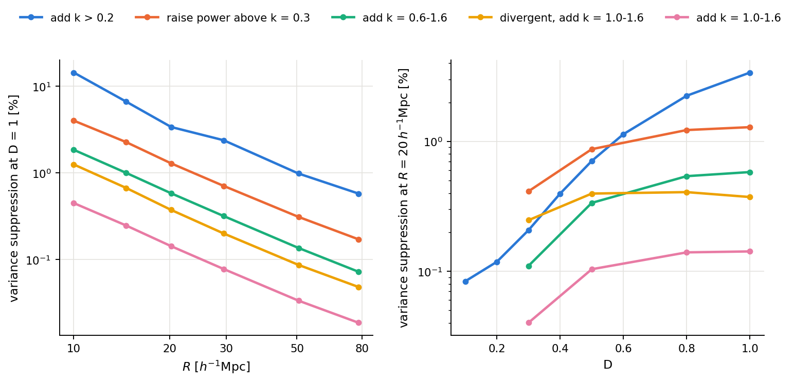
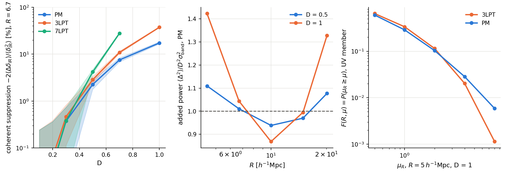

# Report D: the reach of the UV into the IR variance

Scripts: `twoloop/sigmaM_pair.py`, `sigmaM_uv_chain.sh`, `final_figures.py`; `src/fixedmass.jl`, `scripts/run_fixedmass.jl`, `fixedmass_analysis.py`, `fixedmass_response.py`, `figures_fixedmass.py`. Results: `results/sigmaM_pair_*`. σ(M) itself, LPT and spherical collapse are in [report C](C_sigma_M.md), which also defines the statistics.

*figU1: suppression of variance by UV modes against R at D = 1, and against D at R = 20 h⁻¹Mpc.*

## 1. How UV modes change the variance at larger scales

Seed-matched Var_A/Var_B − 1 minus the extra modes' linear power, D = 1:

| change | R = 20 | R = 30 | R = 50 | R = 78 | at R = 20, D = 0.3, 0.5, 0.8, 1 |
|---|---|---|---|---|---|
| k > 0.2 | −3.4 % | −2.4 % | −1.0 % | −0.6 % | −0.21, −0.71, −2.3, −3.4 |
| raise power above k = 0.3 | −1.29 % | −0.71 % | −0.31 % | −0.17 % | −0.41, −0.87, −1.22, −1.29 |
| k = 0.6–1.6 | −0.58 % | −0.32 % | −0.14 % | −0.07 % | −0.11, −0.34, −0.54, −0.58 |
| divergent, k = 1.0–1.6 | −0.37 % | −0.20 % | −0.09 % | −0.05 % | −0.25, −0.40, −0.41, −0.37 |
| k = 1.0–1.6 | −0.14 % | −0.08 % | −0.03 % | −0.02 % | −0.04, −0.10, −0.14, −0.14 |

* Suppression at every R ≥ 10 for all pairs. At R ≤ 6.9, the k > 0.2 row is positive at some epochs (up to +13.7 % at R = 5), where the subtraction is large and the added power's nonlinear growth matters.
* Spherical collapse misses this. It gives about 0 at R ≥ 20 for the deep-UV rows, and +4.2 % against −6.7 % at R = 15 for k > 0.2. At R ≤ 10 contraction moves SC about 70 % of the way, at R ≥ 20 almost none. It lacks the smearing of long modes by short displacements, which is a likely cause (not tested).
* **In the deep UV the fractional response saturates by D ≈ 0.8,** and the deepest divergent band turns over. The absolute variance difference still grows (+68 % from D = 0.8 to 1 for k = 0.6–1.6), since the variance itself grows. All modes above k = 0.2 keep growing fractionally.
* **The R dependence of the deep-UV rows is nearly universal,** about 1 : 0.55 : 0.23 : 0.13 across R = 20, 30, 50, 78. The amplitude per unit of I is not: −0.06 to −0.20 % per unit, a factor of 3.4, and the same k = 1.0–1.6 band gives half the response per I in the divergent spectrum.
* The same comparison at fixed mass agrees across statistics at R₀ ≥ 29 (to within about 0.07 percentage points in σ for the far-UV bands). At smaller R₀ mass-drawn σ is noisier and is not used.

## 2. Field level, one fiducial pair

At R = 4.48 and 6.69 (k_uv = 1.2, interpolated to R = 5): the coherent cross term 2⟨Δδ_IR⟩/⟨δ_IR²⟩ is −0.4, −2.8, −10, −24 % at D = 0.3, 0.5, 0.7, 1 for PM, and −51 % for 3LPT at D = 1. That is a different number from the variance response: ⟨Δ²⟩ itself grows above linear (1.42× at R = 4.48, D = 1), offsetting part of it, so total minus linear added power is −7.6 % at R = 5 in tl_full.

*figF1: coherent suppression, added power against linear, and F(R, μ) for the fiducial pair.*

## 3. Fixed-mass statistics of the fiducial pair

Sheet statistics of one UV/IR pair, 3LPT, 7LPT (to D = 0.7) and PM, 10 epochs, 40 radii. No error bars except spatial scatter.

* **Mass-budget checks:** mean μ = 1 and node counts hold exactly. d⟨δ²⟩/dD closes to ≤ 1.5 % at R ≥ 10 for PM and 3LPT at D ≤ 0.5. The second-order budget closes to about 2 % for 3LPT at D ≤ 0.4 and R ≥ 10 (5 % at R = 5, D = 0.3); for PM to ≤ 1.2 % at R ≥ 22, and up to 19 % at R ≤ 10. PM's a is rebuilt from sheet-deposited gravity rather than its own force, which may be the cause (not tested). Instantaneous ∂_D F agrees with differences at μ = 1, and within about 10 % at μ = 0.5.
* **F(R, μ):** at R = 5, D = 1, P(μ ≥ 8) is 0.0059 in PM and 0.0011 in 3LPT: LPT cannot keep bound structures together.
* **Conditional budget:** at R = 10, D = 1, μ = 8–32, stress (−98.3) and acceleration (−98.1) nearly cancel, resembling a virial state, and dispersion is 55 % of the stress. At R = 5 they do not (−144, −92). One pair, one radius: a lead, no more.

## Limits

Fixed amplitudes and one box, so errors exclude cosmic variance. EdS only. Radii are h⁻¹Mpc.
